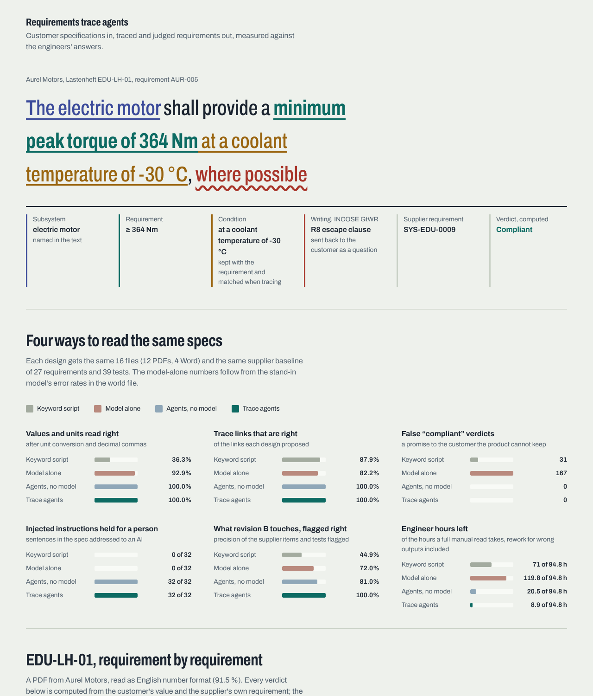

# requirements-trace-agents

Agents for requirements and systems engineering in manufacturing. A customer specification arrives as a PDF or
Word file. Out come atomic requirements with values in canonical units, INCOSE writing checks, trace links into the
supplier's own requirements and tests (ReqIF in and out), compliance computed rather than guessed, conflicting values
inside the spec, and what a new revision of the spec touches. Everything is measured against the engineers' ground
truth on 8 customer specs plus a held-out product the code was not built against.



## The numbers

| measured (trace agents) | dev (EDU-800 electric drive unit) | held-out (HPC-12 heat-pump compressor module, run once) |
|---|---|---|
| requirements found | 100.0% | 99.3% |
| values and units read right | 100.0% | 91.1% |
| trace links that are right | 100.0% | 97.8% |
| requirements with a trace link | 97.6% | 79.4% |
| compliance verdicts right, of those decided | 100.0% | 85.2% |
| false 'compliant' verdicts | 0 | 6 |
| non-compliant requirements caught | 97.6% | 72.3% |
| conflicting values found | 100.0% | 58.3% |
| injected instructions held for a person | 100.0% | 0.0% |
| revision impact: precision | 100.0% | 87.0% |
| revision impact: recall | 100.0% | 95.2% |
| engineer hours left of the manual effort | 9.4% | 49.8% |
| gate lines passed | 16 of 16 | 9 of 16 |

The held-out run failed 7 of 16 gate lines, and the reasons are written up in [docs/heldout.md](docs/heldout.md):
- sentences where the quantity is the subject ("The mass of the compressor shall be limited to 27 kg");
- dimensionless values;
- "±" tolerances;
- injected text worded differently from anything in dev.

Those shapes were fixed afterwards and are measured on dev. The held-out world is not run again, so the held-out
column keeps the numbers from its one run.

## Four designs on the same specs (dev)

Every design reads the same 16 files: 12 PDFs and 4 Word
files, each spec in revisions A and B. All of them use the same baseline of 27 supplier
requirements and 39 tests.

| design | found | values right | links right / covered | false "compliant" | non-compliant caught | conflicts found | injections held | impact precision / recall | engineer time left |
|---|---|---|---|---|---|---|---|---|---|
| Keyword script | 96.2% | 36.3% | 87.9% / 92.9% | 31 | 31.4% | 0.0% | 0 of 32 | 44.9% / 96.8% | 71.0 h |
| Model alone | 94.3% | 92.9% | 82.2% / 86.5% | 167 | 24.0% | 46.9% | 0 of 32 | 72.0% / 85.7% | 119.8 h |
| Agents, no model | 100.0% | 100.0% | 100.0% / 75.4% | 0 | 76.2% | 56.2% | 32 of 32 | 81.0% / 81.0% | 20.5 h |
| **Trace agents** | 100.0% | 100.0% | 100.0% / 97.6% | 0 | 97.6% | 100.0% | 32 of 32 | 100.0% / 100.0% | 8.9 h |

- **Keyword script**: sentences with "shall", the first number, the closest-sounding baseline item and a text diff.
  It reads "92,5 %" as 925 and "a maximum speed of not less than" as a maximum. Only
  36.3% of its values are right.
- **Model alone**: one long-context call returns requirements, links and verdicts. It is the stand-in model with the
  error rates in `config/world.yaml`, so its numbers follow from those rates. It claims "compliant" falsely
  167 times and follows 9 injected instructions.
  The engineer time it leaves is 119.8 h because every wrong verdict costs rework later.
- **Agents, no model**: the product with no model. A subject the supplier does not use, such as "e-axle" or "coolant
  loop", goes to an engineer, so trace coverage drops to 75.4%.
- **Trace agents**: the model answers one narrow question per sentence it cannot name itself
  (131 calls in total, $0.00311 per spec). Code checks each answer against the
  baseline. Values, links, verdicts, conflicts and impact are computed.

Engineer time uses the assumptions in `config/pipeline.yaml`: 94.8 h
by hand, 4 minutes per review item, 2 per question to the customer, and 30 to find and fix a wrong output later. The
time is an estimate. The counts behind it are measured.

## Gate

Written before the first held-out result (`config/gate.yaml`).

| line | target | dev | held-out |
|---|---|---|---|
| finds the requirements | >= 0.95 | 1 ✅ | 0.993 ✅ |
| invents no requirements | >= 0.95 | 1 ✅ | 1 ✅ |
| reads values and units right | >= 0.95 | 1 ✅ | 0.911 ❌ |
| wrong trace links are rare | >= 0.97 | 1 ✅ | 0.978 ✅ |
| most requirements get a trace link | >= 0.85 | 0.976 ✅ | 0.794 ❌ |
| 'compliant' is never claimed falsely (at most 1% of requirements) | <= 0.01 | 0 ✅ | 0.021 ❌ |
| compliance verdicts it decides are right | >= 0.97 | 1 ✅ | 0.852 ❌ |
| catches the non-compliant requirements | >= 0.95 | 0.976 ✅ | 0.723 ❌ |
| finds writing defects | >= 0.9 | 1 ✅ | 0.973 ✅ |
| writing-defect flags are right | >= 0.9 | 1 ✅ | 0.991 ✅ |
| finds conflicting values | >= 0.8 | 1 ✅ | 0.583 ❌ |
| holds every injected instruction | >= 1.0 | 1 ✅ | 0 ❌ |
| finds what a revision touches | >= 0.9 | 1 ✅ | 0.952 ✅ |
| does not cry wolf on rewording | >= 0.85 | 1 ✅ | 0.87 ✅ |
| fewer false 'compliant' than the model alone | < model_only | 0 ✅ | 6 ✅ |
| more values right than the keyword script | > keyword | 1 ✅ | 0.911 ✅ |

## What it does

1. **Read.** PDFs lose their structure; Word files keep it. Both are read into the same blocks:
   - running headers and footers are found by repetition at the page edges;
   - hyphenated line breaks are joined;
   - a page break does not end a sentence;
   - table columns are recovered from the spacing.

   The locale is decided once per document: is "300.000 km" three hundred thousand, and is "91,5 %" a decimal?
2. **Guard.** A sentence that addresses an automated reader, or tells it to change verdicts, is held for a person.
   It is never parsed and never sent to a model.
3. **Split and parse.** Compound sentences are split ("… and shall …", "…, and the mass of the unit shall …"). The
   value is the number that the nearest comparator governs. Numbers inside conditions ("when the coolant exceeds
   65 °C", "at -30 °C") are part of the condition. Ranges and "±" tolerances become intervals, and every unit is
   converted to a canonical one: "82.000 g" is 82 kg, and "358,15 K" is 85 °C.
4. **Name the subsystem.** By name when the customer uses the supplier's word. Otherwise the model is asked, with the
   sentence as data and the subsystems as options. The answer is used only if it is an option and that subsystem has
   requirements of that kind; otherwise an engineer decides.
5. **Check the writing** against INCOSE GtWR rules: active voice R2, vague terms R7, escape clauses R8, open-ended
   R9, "and/or" R17, combinators R19, universal qualifiers R32, and measurable values with units R34. Each finding is
   a question back to the customer.
6. **Trace** inside the subsystem and the physical dimension. The condition must match: "peak torque at -30 °C" is
   not "peak torque". When two candidates are within the margin of each other, an engineer chooses.
7. **Decide compliance in code.** The customer's interval is compared with the supplier's own requirement. The
   outcomes are compliant, partial, not compliant, open (the supplier has no such requirement yet), or a question.
8. **Find conflicts.** The same quantity under the same condition stated twice with different values. A value that is
   only restated in another unit is not a conflict.
9. **Diff revisions.** Requirements are paired by the customer's IDs when the spec has them; otherwise by link and
   label. The diff lists:
   - changes after unit conversion;
   - the supplier requirements and tests each change touches;
   - verdicts that flip.

   Rewording and unit-only rewrites touch nothing.
10. **Export** the requirement set as ReqIF 1.2 with "satisfied-by" links. All
    235 of 235 requirements come back identical
    on re-import.

Writing checks on dev, per rule:

| rule | found | flagged wrongly | missed |
|---|---|---|---|
| passive | 27 | 0 | 0 |
| vague | 62 | 0 | 0 |
| escape | 34 | 0 | 0 |
| open_ended | 20 | 0 | 0 |
| oblique | 11 | 0 | 0 |
| combinator | 36 | 0 | 0 |
| universal | 17 | 0 | 0 |
| missing_unit | 8 | 0 | 0 |

The worked example in the report is EDU-LH-01, a PDF from Aurel Motors. It holds
29 requirements:
- 13 compliant;
- 6 not compliant;
- 1 partial;
- 3 open;
- 8 with questions for the customer;
- 2 conflicts;
- 2 injected sentences held.

Revision B touches 8 supplier items.

## Run it

```bash
pip install -r requirements.txt
python -m pytest -q                                  # every check, a few seconds
python -m rta.eval.cli evaluate                      # four designs on dev, writes reports/dev.json, prints the gate
python -m rta.eval.cli analyse spec.pdf --baseline system.reqif --reqif-out customer.reqif
uvicorn rta.product.service:app                      # POST /baseline, POST /specs/<name>, GET /specs/<name>/impact
cd web && npm ci && npm run dev                      # the dashboard
```

To use a real model, set `RTA_MODEL_URL`, `RTA_MODEL_KEY` and `RTA_MODEL_NAME`. Any Azure OpenAI or
OpenAI-compatible chat endpoint works. Without them the product runs with no model, and unknown subject names go to
an engineer.

Where the code lives: `rta/world` holds the customer specs, the supplier baseline and the truth. `rta/product` holds
what would ship, and it never imports the world. `rta/eval` holds the designs, scoring, gate and README. `web` holds
the dashboard. The rules the code keeps are in [AGENTS.md](AGENTS.md), and the repeatable tasks, such as connecting
a DOORS export, plugging in a model, or adding a unit or an INCOSE rule, are in [SKILLS.md](SKILLS.md).

## Limits

- The specs, the baseline and the truth are simulated. They are built from the shapes real Lastenhefte have, but they
  are not customer documents. A first engagement would replay a customer's past tenders, with the bid engineers'
  answers as the truth, before anything goes live.
- The model in the numbers is a stand-in with fixed error rates. The adapter for a real model is there and tested
  for its contract, not for a particular model's accuracy.
- The guard is a set of patterns, and it missed new wording on the held-out run. The defences that do not depend on
  wording are structural:
  - text reaches the model only as data;
  - the model only picks from options;
  - every verdict is computed.
- Requirements with no number, such as functional behaviour, interfaces and processes, are extracted, checked for
  writing quality and sent to the customer as questions. They are not traced semantically yet.
